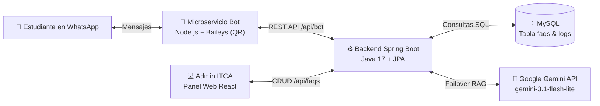

# 🏛️ ITCA Santa Ana · WhatsApp Bot & Panel Administrativo

Sistema integral para **ITCA-FEPADE Centro Regional Santa Ana** que combina un **Bot conversacional para WhatsApp** y una **Plataforma Web Administrativa** donde el personal institucional puede agregar, editar, pausar o eliminar preguntas y respuestas oficiales en tiempo real.

---

## 🏗️ Arquitectura del Sistema



---

## 📂 Módulos del Proyecto

1. **`demo/` (Backend Spring Boot - Puerto 8080)**:
   - Endpoints CRUD para el panel: `GET`, `POST`, `PUT`, `PATCH`, `DELETE` en `/api/faqs`.
   - Endpoint de autenticación admin: `POST /api/admin/login`.
   - Motor de respuestas híbrido: Coincidencia directa por palabras clave en MySQL + Inteligencia Artificial generativa RAG con Google Gemini.
   - Registro de interacciones en la tabla `whatsapp_logs`.

2. **`ChatBot-Becas/` (Frontend Panel Administrativo - Puerto 5173)**:
   - Desarrollado en **React 19 + TypeScript + Vite + TailwindCSS**.
   - Login institucional con usuario administrador.
   - Gestor completo de preguntas y respuestas (filtros por categoría, buscador, switch de activación, modal de edición).
   - **Simulador de WhatsApp en Vivo**: permite probar cómo responderá el bot a los estudiantes directamente desde la web.
   - Monitor de historial de mensajes recibidos.

3. **`whatsapp-bot/` (Microservicio de WhatsApp - Puerto 3001)**:
   - Desarrollado en **Node.js con @whiskeysockets/baileys**.
   - Vinculación sencilla mediante escaneo de código QR (sin costos de Meta).
   - Envía los mensajes al backend y responde al usuario en WhatsApp automáticamente.

4. **`database/init.sql`**:
   - Tablas `faqs`, `admins`, `whatsapp_logs`.
   - Precargado con las 29 preguntas y respuestas oficiales de ITCA Santa Ana (admisión, aranceles, carreras, becas, horarios, sedes).

---

## 🚀 Guía Rápida de Inicio

### 1. Base de Datos MySQL
En MySQL Workbench o terminal ejecuta:
```sql
SOURCE database/init.sql;
```

### 2. Backend (Spring Boot)
```bash
cd demo
./mvnw spring-boot:run
```
Disponible en `http://localhost:8080`.

### 3. Panel Web Administrativo
```bash
cd ChatBot-Becas
npm install
npm run dev
```
Disponible en `http://localhost:5173`.
Credenciales de acceso:
- **Correo:** `admin@itca.edu.sv`
- **Contraseña:** `itca`

### 4. Bot de WhatsApp (Para vincular número real)
```bash
cd whatsapp-bot
npm install
npm start
```
Escanea el código QR que aparecerá en la terminal con WhatsApp en tu celular y ¡listo!
